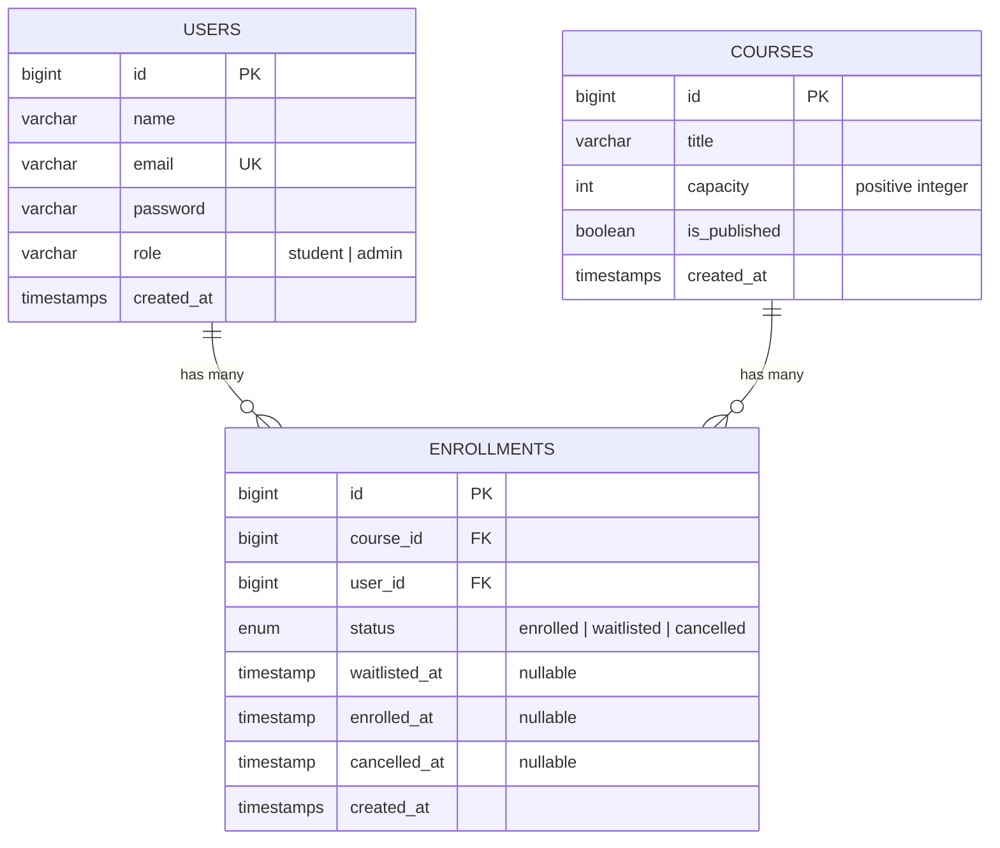
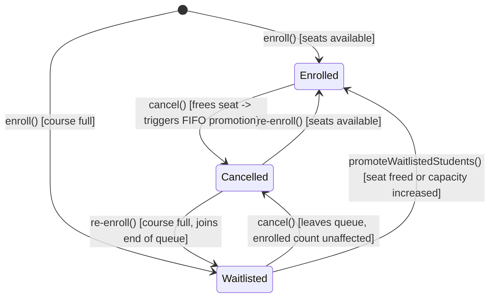

# LearnHub LMS — Architecture & System Design

## 1. Application Structure

The project is structured as a decoupled monorepo containing two independent applications:

- **`server/`** — Laravel 12 REST API (PHP 8.2+), utilizing Eloquent ORM, Laravel Sanctum Bearer tokens, Form Requests, and MySQL (InnoDB).
- **`client/`** — React 19 application built with Vite 8, React Router 8, and Tailwind CSS 4, structured into feature-oriented modules with an Axios API layer.
- **`docs/`** — Documentation assets, design reference, architecture specifications, and test reports.

```
lms-assignment/
├── client/                     # Frontend (React 19, Vite, Tailwind CSS)
│   ├── src/
│   │   ├── components/         # Shared UI (Sidebar, Header, ProtectedRoute)
│   │   ├── features/
│   │   │   ├── admin/          # CourseModal (CRUD & capacity management)
│   │   │   └── auth/           # AuthContext (state & session management)
│   │   ├── layouts/            # AppLayout (Sidebar + Header + Outlet)
│   │   ├── lib/                # api.js (Axios instance with Bearer interceptor)
│   │   ├── pages/              # Catalog, Enrollments, Admin Dashboard & Courses
│   │   ├── App.jsx             # React Router route declarations
│   │   └── main.jsx
│   └── vite.config.js          # Development proxy (/api -> http://127.0.0.1:8000)
├── server/                     # Backend (Laravel 12 API)
│   ├── app/
│   │   ├── Http/
│   │   │   ├── Controllers/    # Auth, Course, StudentEnrollment, AdminCourse
│   │   │   ├── Middleware/     # EnsureAdmin
│   │   │   └── Requests/       # Form Requests for input validation & authorization
│   │   ├── Models/             # User, Course, Enrollment
│   │   └── Services/           # EnrollmentService (dedicated transactional domain logic)
│   ├── database/
│   │   ├── migrations/         # Schema, constraints, indexes
│   │   ├── factories/          # Test model factories
│   │   └── seeders/            # DatabaseSeeder (Demo admin, student, sample courses)
│   └── tests/                  # Unit and Feature automated tests
└── docs/                       # Architecture, Test Plan, and Design Reference
```

---

## 2. Database Schema, Constraints & Indexes

The data model uses three primary InnoDB tables with strict relational integrity and composite indexes.



### Required Constraints & Index Strategy
1. **Uniqueness Safeguard**: `UNIQUE(course_id, user_id)` on `enrollments` guarantees at the database level that a student can never have more than one record per course.
2. **Student Dashboard Query Optimization**: `INDEX(user_id, status)` optimizes student queries retrieving active enrollments and waitlist positions (`/api/me/enrollments`).
3. **Deterministic FIFO Waitlist Optimization**: Composite index `INDEX(course_id, status, waitlisted_at, id)` allows MySQL to resolve candidate waitlisted students for immediate promotion in exact FIFO order without filesort overhead.
4. **Referential Integrity**: Foreign keys `course_id -> courses.id` and `user_id -> users.id` with `CASCADE ON DELETE`.
5. **No Separate Available-Seat Column**: Available seats are computed on-demand via `max(0, capacity - enrolled_count)`, eliminating denormalization drift and stale counters. Subquery counts (`withCount`) avoid N+1 queries.

---

## 3. Concurrency Strategy & Pessimistic Row Locking

To prevent race conditions, over-allocation, and lost seat reservations in concurrent environments, all seat-altering operations execute inside a transactional course-first lock pattern:

```
[Incoming Request]
        │
        ▼
[Begin Transaction] ──► Course::where('id', $id)->lockForUpdate()->firstOrFail()
                                │
        ┌───────────────────────┴───────────────────────┐
        ▼                                               ▼
[Enrollment / Waitlisting]                    [Cancellation / Capacity Change]
Re-check publication status &                 Update record status / course capacity
re-count enrolled seats inside lock           Trigger FIFO promotion if seat freed
        │                                               │
        └───────────────────────┬───────────────────────┘
                                ▼
                       [Commit Transaction]
```

### Principles:
1. **Consistent Lock Order**: Every code path that changes capacity, enrolls a student, cancels an enrollment, or promotes waitlisted students acquires `lockForUpdate()` on the target `courses` row first. Following identical lock ordering prevents circular deadlocks.
2. **Re-Verification Inside the Lock**: Seat availability and publication status are never assumed from the HTTP request or cache. Enrolled counts are calculated strictly inside the transaction after acquiring the row lock:
   $$\text{Available Seats} = \max(0, \text{capacity} - \text{enrolled\_count})$$
3. **Automatic Deadlock Retries**: `DB::transaction(fn() => ..., 3)` provides up to 3 automatic retries for transient deadlock exceptions.
4. **Short Transactions**: No remote network calls, HTTP requests, or external side effects are performed inside the transaction block.

---

## 4. Enrollment Business Rules & State Transitions



### 1. Enrollment (`enroll`)
- Rechecks `is_published`. If false, rejects with HTTP 422.
- Queries existing enrollment record:
  - If already `enrolled` or `waitlisted`: Returns existing state idempotently (HTTP 200) without altering waitlist position.
  - If existing record was `cancelled`: Reactivates the existing row. If seats are open, assigns `enrolled` status; if full, assigns `waitlisted` status with `waitlisted_at = now()`, placing them at the back of the queue.
  - If no record exists: Creates `enrolled` (HTTP 201) if `enrolled_count < capacity`, otherwise creates `waitlisted` with `waitlisted_at = now()` (HTTP 201).
- Safely catches database `UniqueConstraintViolationException` in race conditions.

### 2. Cancellation (`cancel`)
- Verifies that the record belongs to the authenticated student and is not already `cancelled`.
- Repeated cancellations throw HTTP 422, preventing a single enrollment from freeing multiple seats.
- If cancelling an `enrolled` record: Sets `status = 'cancelled'`, `cancelled_at = now()`, and immediately runs `promoteWaitlistedStudents()`.
- If cancelling a `waitlisted` record: Sets `status = 'cancelled'`. Does not affect enrolled count and does not trigger promotions.
- Existing students are permitted to cancel their records even if the course has been unpublished.

### 3. Immediate Deterministic FIFO Promotion (`promoteWaitlistedStudents`)
- **Triggers**:
  - An enrolled student cancels their seat (`cancel()`).
  - An administrator increases course capacity (`updateCapacity()`).
  *(Note: Cancelling a waitlist position does not trigger promotion since no enrolled seat was freed).*
- **Ordering**:
  - Strictly deterministic FIFO: `ORDER BY waitlisted_at ASC, id ASC`.
- **Workflow**:
  1. Re-calculates open seats: `availableSeats = max(0, capacity - enrolled_count)`.
  2. Queries up to `availableSeats` records where `status = 'waitlisted'`.
  3. Updates each selected waiter: sets `status = 'enrolled'`, `enrolled_at = now()`, and `waitlisted_at = null`.
- **Concurrency Safety**:
  - Runs inside the caller's database transaction with the course row locked (`lockForUpdate()`), ensuring no race conditions or overbooking during simultaneous requests.

### 4. Dynamic Capacity Modifications (`updateCapacity`)
- Enforces positive integer capacity (`capacity >= 1`).
- Locks the course row.
- **Capacity Increase**: Calls `promoteWaitlistedStudents()` to promote waiters in FIFO order until the course is full or the waitlist is empty.
- **Capacity Decrease**: Never deletes or cancels existing enrolled records. If enrolled students exceed the new capacity, their enrollments are preserved, and new enrollments/promotions remain blocked until capacity permits.

---

## 5. Authorization Boundaries

1. **Role Separation**:
   - `student`: Can view published courses, enroll, cancel own records, and view own profile/enrollments. Cannot access `/api/admin/*`.
   - `admin`: Can view all courses (published & drafts), create courses, adjust capacities, and toggle publication status.
2. **Ownership Enforcement**:
   - Student ID is never accepted as a request body parameter for enrollments. All student actions derive the subject from `$request->user()`.
3. **Defense in Depth**:
   - Backend route middleware (`EnsureAdmin`) authoritatively blocks non-admin access (HTTP 403).
   - Frontend `ProtectedRoute` directs navigation, but the backend remains the single source of truth.

---

## 6. Design Trade-Offs

| Decision | Trade-Off | Rationale |
| :--- | :--- | :--- |
| **Sanctum Bearer Tokens vs Session Cookies** | `localStorage` is vulnerable to XSS compared to `HttpOnly` cookies | Avoids cross-port cookie and CSRF setup issues between Vite (port 5173) and Laravel (port 8000). |
| **Vite Dev Proxy vs CORS headers** | Only works in local dev; production needs a reverse proxy or CORS setup | Avoids browser CORS preflight (`OPTIONS`) delays and simplifies API requests. |
| **Dedicated Service (`EnrollmentService`)** | Adds an extra layer while basic course CRUD stays in controllers | Keeps transactions, row locks, and FIFO promotion in one testable place. |
| **Pessimistic Locking (`lockForUpdate`)** | Requests wait on the row lock, slightly lowering write throughput under heavy load | Prevents overbooking without complex retry logic or version columns. |
| **Immediate Waitlist Promotion** | Promotes students automatically without a confirmation window | Avoids needing background workers, cron jobs, and email infrastructure. |
| **SQLite In-Memory for Tests** | Does not test real MySQL row-locking behavior | Keeps tests ultra-fast and requires zero database configuration to run. |